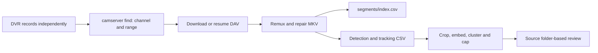
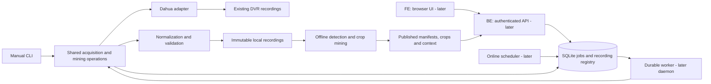

# Personal Neovim and Kitty configuration

My LazyVim configuration for editing code, Markdown, LaTeX, PDFs, and Jupyter notebooks. It includes the current plugin specifications, keymaps, editor options, colorschemes, and `lazy-lock.json` so other computers can restore the same plugin revisions.

This private repository also contains the Kitty terminal configuration in [`kitty/kitty.conf`](kitty/kitty.conf). See [`README-kitty.md`](README-kitty.md) for its shortcuts, installation, and update workflow. Neovim stays at the repository root so it can be cloned directly into `~/.config/nvim`.

## Install on another computer

Install Neovim with LuaJIT (at least 0.11.2; this snapshot was tested with 0.12.3), Git, a C compiler, ripgrep, and fd. A Nerd Font is recommended for icons. Authenticate the computer's SSH key with GitHub because this repository is private.

If a Neovim configuration already exists, move it to a backup before cloning. The clone command below will not overwrite an existing directory.

On macOS or Linux:

```sh
mkdir -p "${XDG_CONFIG_HOME:-$HOME/.config}"
git clone git@github.com:mruniverse8/nvim-config.git "${XDG_CONFIG_HOME:-$HOME/.config}/nvim"
mkdir -p "$HOME/vaults/personal"
nvim
```

To install the included Kitty configuration too, follow [the Kitty setup instructions](README-kitty.md#installation). The Kitty installer refuses to overwrite an existing config.

The personal vault directory is used by the Obsidian plugin; its notes are not part of this repository. Change its path in `lua/plugins/obsidian.lua` if needed.

Lazy installs the plugins on first launch. Then run `:Lazy restore` to apply the committed revisions and `:checkhealth` to check local dependencies. A noninteractive restore is also available:

```sh
nvim --headless "+Lazy! restore" +qa
```

On Windows, Neovim normally reads `$env:LOCALAPPDATA\nvim`. Clone there using PowerShell:

```powershell
git clone git@github.com:mruniverse8/nvim-config.git "$env:LOCALAPPDATA\nvim"
New-Item -ItemType Directory -Force "$HOME\vaults\personal"
nvim
```

The complete image, math, PDF, and notebook setup has not been tested on Windows. The current configuration uses Kitty for image rendering; individual features require the dependencies below.

## Pull configuration updates

On macOS or Linux:

```sh
git -C "${XDG_CONFIG_HOME:-$HOME/.config}/nvim" pull --ff-only
nvim --headless "+Lazy! restore" +qa
```

On Windows:

```powershell
git -C "$env:LOCALAPPDATA\nvim" pull --ff-only
nvim --headless "+Lazy! restore" +qa
```

Restart any running Neovim sessions afterward. Commit or stash local edits before pulling if Git reports a conflict. Use `:Lazy restore` to reproduce the lockfile; `:Lazy update` intentionally changes plugin versions. [Lazy lockfile documentation](https://lazy.folke.io/usage/lockfile).

## Save changes from this computer

```sh
cd "${XDG_CONFIG_HOME:-$HOME/.config}/nvim"
git status
git add -A
git commit -m "Update Neovim configuration"
git push
```

Include `lazy-lock.json` whenever you intentionally update plugins. Plugin downloads, Mason tools, Python environments, caches, and personal notes live outside this configuration and are installed separately on each computer.

## Dependencies and optional features

On macOS, start with:

```sh
brew install neovim git ripgrep fd lazygit
```

Install a C compiler through the Xcode Command Line Tools if one is not already available. On Linux, install the equivalent packages through your distribution, checking that its Neovim version meets the requirement above.

| Feature | Local requirements |
| --- | --- |
| Markdown | Markview and Tree-sitter parsers, installed by Lazy. The duplicate `render-markdown.nvim` renderer is disabled to prevent icons covering heading text. |
| Mermaid in Markdown | Snacks, Kitty, the Markdown Tree-sitter parser, ImageMagick, and `mmdc` from `@mermaid-js/mermaid-cli` (including its Puppeteer browser). See below. |
| Images and math | Kitty, ImageMagick, Node.js/npm, and `rsvg-convert` from librsvg. Run `:MdMath build` if the math renderer needs rebuilding. |
| PDF preview | ImageMagick, Ghostscript, and Poppler utilities; a terminal supporting image display. |
| Jupyter notebooks | Python 3.10+, Jupytext, Jupyter, and a Neovim Python provider with `pynvim` and `jupyter_client`. Run `:UpdateRemotePlugins` after setting up the provider. |
| LaTeX | A TeX distribution and its build tools; Skim on macOS or Zathura on Linux for external PDF viewing. |
| Obsidian | A vault at `~/vaults/personal`, or an adjusted path in `lua/plugins/obsidian.lua`. |

macOS packages for the optional workflows:

```sh
brew install imagemagick librsvg node ghostscript poppler jupyterlab jupytext
brew install --cask kitty skim
```

Use `:checkhealth provider` to verify Neovim's Python environment and `:Mason` to install language tools for the languages you use.

## Mermaid diagrams inside Markdown

Snacks renders each fenced `mermaid` block below its visible source in Kitty.
Open a Markdown file normally; previews refresh as the buffer changes. The
Markdown stays plain text, and generated images live under Neovim's cache at
`snacks/image`. No separate Mermaid Neovim plugin is required.
When code wraps in a narrow split, Snacks may place the preview near the opening
fence instead of below the whole block; widen the split for the normal layout.

Install the renderer using a Node.js/npm installation owned by your user:

```sh
npm install -g @mermaid-js/mermaid-cli
mmdc --version
```

The CLI uses a local Puppeteer browser to render diagrams. Allow its browser
installation to complete. See the [Mermaid CLI documentation](https://github.com/mermaid-js/mermaid-cli)
and [Puppeteer troubleshooting](https://pptr.dev/troubleshooting) for browser
installation or launch failures. Use a Node version supported by the CLI.

Restart Neovim inside Kitty and run `:checkhealth snacks`. Check that `mmdc` and
ImageMagick are found, the Markdown parser is installed, and the terminal supports
inline images. `:echo executable('mmdc')` should return `1`; if it returns `0`,
ensure your npm prefix's `bin` directory is on Neovim's PATH. Invalid diagrams
show a conversion error in `:messages`; correct the source to render again.

Diagrams preserve their aspect ratio and fit within 160 columns by 40 rows and
the available text area, excluding line-number/sign columns. Mermaid renders at
twice the terminal's normal pixel density for sharper text and lines without
increasing the displayed size. Long `flowchart LR` diagrams can have small labels
in a narrow window; widen Kitty or maximize the editor split. The existing
`<leader>i+`, `<leader>i-`, and `<leader>i0` shortcuts configure image.nvim output,
not Snacks diagrams. Math keeps its existing concealment behavior.

These two examples are also the rendering smoke-test fixtures:



Proposed smaller system; nodes explicitly marked later are not milestone 3 code:



## Configuration layout

- `init.lua`: starts the configuration.
- `lua/config/lazy.lua`: bootstraps Lazy and loads LazyVim and custom plugins.
- `lua/config/`: editor options, keymaps, and autocmds.
- `lua/plugins/`: plugin settings, including Markdown, notebooks, PDF preview, themes, and PetsADHD.
- `lazy-lock.json`: the saved plugin revisions.
- `lazyvim.json`: enabled LazyVim extras and configuration metadata.
- `install-macos.sh`: optional symlink installer for a checkout stored elsewhere; it also uses portable shell commands on Linux and refuses to overwrite an existing config.
- `kitty/kitty.conf`: a complete copy of the Kitty configuration saved from this Mac, including commented option documentation.
- `README-kitty.md`: Kitty setup, shortcuts, and instructions for saving future changes.
- `install-kitty.sh`: links the saved Kitty config into the standard config directory without overwriting an existing file.

Based on [LazyVim's starter configuration](https://github.com/LazyVim/starter); its existing Git history and license are retained.

## Pomodoro pets (NVIM-2)

Run `:Pomodoro` or `<leader>uO` for an animated focus timer inside LazyVim.
The existing PetsADHD sidebar artwork supplies T-rex, dog, duck and 67 companions.
Default cycle: 25-minute focus, 5-minute break, 15-minute break after every four
completed focus sessions. Phases advance automatically. A new session runs;
a saved session reopens paused. Hidden editor timers keep running.

```sh
~/.config/nvim/bin/pomodoro --check
~/.config/nvim/bin/pomodoro
~/.config/nvim/bin/pomodoro --focus 50 --short-break 10 --long-break 30
~/.config/nvim/bin/pomodoro --mute
~/.config/nvim/scripts/install-pomodoro.sh
```

The installer adds **Pomodoro pets** to the application menu and Desktop. GNOME
may require right-click → **Allow Launching**. Keep the checkout at its installed
location; rerun the installer after moving it. It refuses unrelated launchers.
Remove these two files to uninstall the shortcuts:
`~/.local/share/applications/pomodoro-pets.desktop` and
`$(xdg-user-dir DESKTOP)/Pomodoro pets.desktop`. The source stays in this repo.
The installer requires Python 3 and `xdg-user-dir`; optional `gio` marks it trusted.

| Key | Action |
| --- | --- |
| Space | Pause/resume |
| r | Reset cycle to paused focus |
| n | Next pet (shares the sidebar selection in the editor) |
| m | Toggle focus music |
| a | Toggle boundary alerts |
| q | Hide editor panel, or save and exit desktop app |

`:Pomodoro start`, `pause`, `resume`, `reset`, and `stop` are also available.
`stop` saves paused and hides the panel. Edit `lua/config/pomodoro.lua` for shared
durations, cycle count, music URL/volume and alert settings. Lua callers can use
`require("pomodoro").setup(opts)` and inspect `require("pomodoro").status()`.
Saved sessions retain their original durations until reset; launcher flags set the
next fresh/reset session defaults. Pets keep animating when the timer is paused.

Desktop requires Linux, Kitty, Neovim 0.11+, `flock`, and an installed PetsADHD
plugin (`:Lazy restore` on a new machine). The minimal desktop bootstrap loads
only the timer and pet modules. Music uses the existing PetsADHD soundtrack,
`ffplay`, `yt-dlp`, and its supported JavaScript runtime; phase alerts use an
FFplay-generated tone. Missing audio dependencies leave the timer usable.
No audio is downloaded or bundled by this feature.

The launcher accepts executable paths through `POMODORO_NVIM` and
`POMODORO_KITTY`; override plugin location with `POMODORO_PETS_DIR`. On this
machine the Snap wrapper cannot run inside automation; isolated tests use:

```sh
POMODORO_NVIM=/snap/nvim/current/usr/bin/nvim \
VIMRUNTIME=/snap/nvim/current/usr/share/nvim/runtime \
  ~/.config/nvim/bin/pomodoro --check
```

State lives in Neovim's state directory under `pomodoro/`: desktop is separate
from editor sessions keyed by working directory. A second owner of the same
state file is rejected; use `POMODORO_STATE_FILE` for an additional desktop timer
or `state_file` in Lua options for another editor timer. Kernel locks release on
process exit. Saves are atomic, every five seconds and on controls/transitions.
A crash can lose up to five seconds; closed time and Linux suspend time are not
counted. Corrupt saves are preserved with an `.invalid-*` suffix and recover paused.
Unreadable saves remain untouched. There is no background service or synchronization.
Music continues while a running editor panel is hidden; closing Neovim stops it.

Run `scripts/test-pomodoro.sh` with a working `POMODORO_NVIM`. Tests use fake clocks
and audio stubs; they do not stream music. See [the feature spec](docs/specs/pomodoro-pets.md)
and CHANGES.md for acceptance results and live-test limitations.
